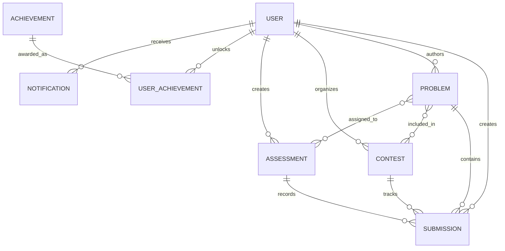

# Codex Platform: Architecture & System Design Documentation

## 1. System Architecture Overview

Codex is architected as a distributed, decoupled multi-service platform separating user management and business APIs from untrusted code execution.

```
                              ┌────────────────────────┐
                              │  React 18 + Vite SPA   │
                              │ (Tailwind + Monaco UI) │
                              └───────────┬────────────┘
                                          │
                                HTTP REST │ WebSocket (Socket.IO)
                                          ▼
                              ┌────────────────────────┐
                              │    Express API Gateway  │
                              │ (Auth, RBAC, CRUD, IO) │
                              └─────┬────────────┬─────┘
                                    │            │
            ┌───────────────────────┘            └─────────────────────────┐
            ▼                                                              ▼
┌───────────────────────┐                                      ┌───────────────────────┐
│     MongoDB 8.0       │                                      │   Execution Service   │
│ (Users, Problems,     │                                      │ (Isolated Sandboxing) │
│ Submissions, Contests)│                                      └───────────┬───────────┘
└───────────────────────┘                                                  │
                                                                           ▼
                                                              ┌─────────────────────────┐
                                                              │ Child Process Sandbox   │
                                                              │ - Isolated Workspace    │
                                                              │ - Stripped Env & Memory │
                                                              │ - Strict Time Limits    │
                                                              │ - IO Sanitization       │
                                                              └─────────────────────────┘
```

---

## 2. Core Components

### 2.1 Frontend Client (`client/`)
- **Technology**: React 18, Vite, Tailwind CSS, Monaco Editor (`@monaco-editor/react`), Recharts, Lucide React, Socket.IO client.
- **State Management**: React Context (`AuthContext`, `ThemeContext`, `SocketContext`).
- **Features**:
  - Problem explorer with debounced multi-criteria filtering.
  - Interactive Monaco code editor with custom themes, font controls, reset options, and starter templates.
  - Test runner console with custom standard input capabilities.
  - Server-synchronized contest timer resistant to client clock tampering.
  - Candidate timed assessment arena.
  - GitHub-style 365-day submission activity heatmap.

### 2.2 Core API Server (`server/`)
- **Technology**: Node.js, Express.js, Mongoose, Socket.IO, Helmet, Morgan, Express Rate Limit, JWT, Bcrypt.js.
- **Role-Based Access Control (RBAC)**:
  - `student`: Solve problems, test run/submit code, participate in contests, view leaderboards, customize profile.
  - `instructor`: All student permissions + problem authoring, test case configuration (public vs hidden), contest creation, assessment design, candidate performance analytics.
  - `admin`: Full system oversight, user suspension/activation, role upgrades, telemetry charts, submission live streams.
- **Security Features**:
  - Passwords hashed with bcrypt (salt rounds = 10).
  - Rate limiting on authentication and code execution routes.
  - Hidden test cases flagged `select: false` on Mongoose schema, ensuring zero leakage to unprivileged API consumers.
  - Zero arbitrary code execution inside API server process.

### 2.3 Isolated Execution Service (`execution-service/`)
- **Technology**: Node.js microservice running on independent port `5050` with shared internal security token.
- **Sandbox Architecture**:
  1. Creates temporary isolated workspace directory under OS tmp using random UUID suffix.
  2. Injects language-specific runner script (`solution.js`, `solution.py`, `solution.cpp`, `Solution.java`).
  3. Spawns child process with:
     - Stripped environment variables (no access to server secrets, DB strings, or root files).
     - Strict execution timeout timer (kills process via `SIGKILL` on timeout).
     - Stdout/stderr buffers limited to 64KB to prevent buffer overflow attacks.
     - Working directory bound to the ephemeral workspace.
  4. Tests solution against all test cases, piping input via `stdin` and comparing `stdout` against `expectedOutput`.
  5. Cleans up sandbox directory recursively in a `finally` block.
  6. Returns sanitized verdict (`Accepted`, `Wrong Answer`, `Time Limit Exceeded`, `Runtime Error`, `Compilation Error`).

---

## 3. Database Schema Relationships



### Key Models:
- **User**: Authentication, role (`student`, `instructor`, `admin`), contest rating, daily streak tracking (`current`, `longest`, `lastSolvedDate`), solved problem references.
- **Problem**: Metadata, slug, difficulty, topics, tags, starter code templates, hints, editorial, constraints, test cases (`input`, `expectedOutput`, `isPublic`).
- **Submission**: Execution metrics (`executionTime`, `memoryUsed`), test cases passed, verdict, language, sanitized results array.
- **Contest**: Start/End timestamps, duration, participant roster with scores, penalties, and real-time live submissions.
- **Assessment**: Access code, duration, passing percentage, candidate roster, and candidate submission analytics.
- **Achievement & UserAchievement**: Automatic criteria triggers (`problems_solved`, `streak_days`, `contests_joined`).
- **Notification**: Real-time Socket.IO alerts and stored user notifications.

---

## 4. End-to-End Workflow Lifecycles

### 4.1 Untrusted Code Execution Flow
1. User clicks **"Submit"** in Monaco Editor.
2. Client sends `POST /api/submissions/submit` with `problemId`, `language`, `code`.
3. Express API verifies user JWT and queries problem test cases (including hidden test cases).
4. API server dispatches request to `http://localhost:5050/api/execute` with internal authentication token.
5. Execution service creates isolated ephemeral workspace, spawns runner child process with timeout and memory constraints.
6. Execution service compiles/runs code, checks output against test cases, captures execution time and memory.
7. Workspace is recursively destroyed.
8. Execution service returns structured results.
9. API server sanitizes results (masks inputs/outputs of hidden test cases) and saves official `Submission` in MongoDB.
10. If `Accepted` and problem was previously unsolved:
    - Problem added to user's `solvedProblems`.
    - User streak calculated and updated.
    - Asynchronous achievement trigger awards badges and emits notification.
    - If contest or assessment active, participant score and penalty recalculated.
11. Response sent back to client; Monaco console displays verdict.

### 4.2 Contest Lifecycle & Server-Synchronized Timer
1. Instructor or Admin schedules contest with `startTime`, `endTime`, `duration`, and problems.
2. Student registers for contest via `POST /api/contests/:id/register`.
3. Client polls or fetches contest with `serverTime` timestamp.
4. Client countdown timer calculates remaining time relative to server time, preventing client clock tampering.
5. During contest:
   - Client joins Socket.IO room `contest_<contestId>`.
   - Submissions made with `contestId` parameter calculate points and penalty minutes (time from contest start + 20 minutes per failed attempt prior to accept).
   - Socket.IO broadcasts `contest_submission_update` to all room participants, refreshing the live leaderboard in real-time.
6. Contest concludes automatically based on server time, freezing submissions.

---

## 5. Security & Isolation Controls

| Vector | Mitigation |
|---|---|
| **Arbitrary Code Execution** | Code is never evaluated (`eval()`) or executed in the API server. All execution happens in ephemeral child processes with stripped environments. |
| **Infinite Loops / Fork Bombs** | Strict execution timeout (default 2000-4000ms); process terminates immediately via `SIGKILL`. Output buffers truncated at 64KB. |
| **Hidden Test Case Leakage** | `testCases` field configured with `select: false` on Mongoose schema. Student API responses filter test cases to `isPublic: true`. Submission results mask hidden test inputs and expected outputs as `[Hidden]`. |
| **Privilege Escalation** | Registration endpoint strictly restricts roles to `student` or `instructor`. Admin roles cannot be self-registered and require database seeds or existing admin authorization. |
| **Brute Force & DoS** | `express-rate-limit` enforces rate bounds on authentication (30 req / 15 min) and execution (30 runs / 1 min). |
